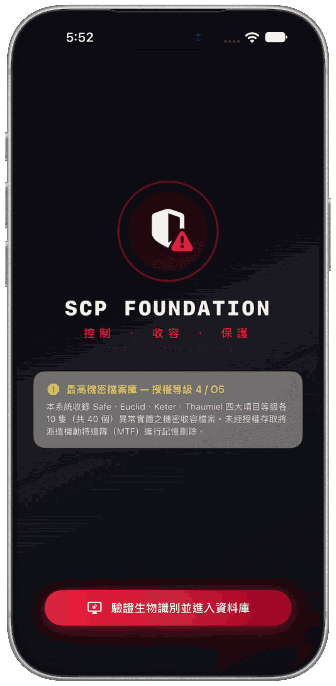
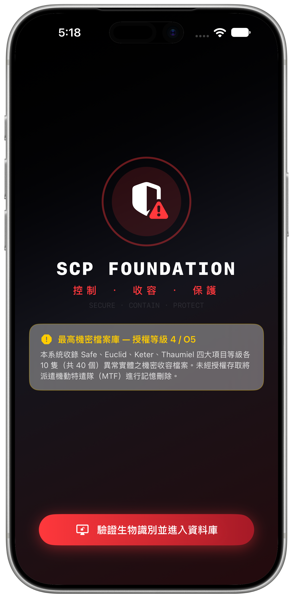
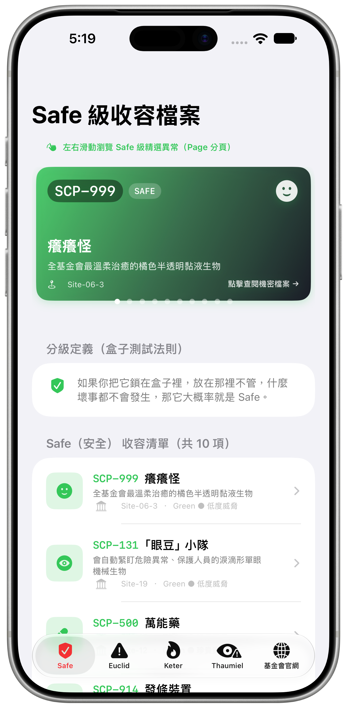
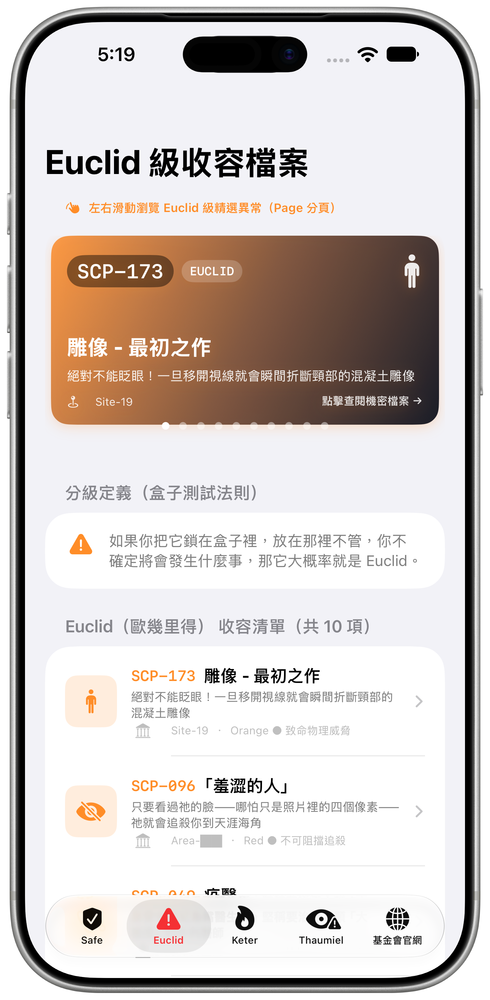
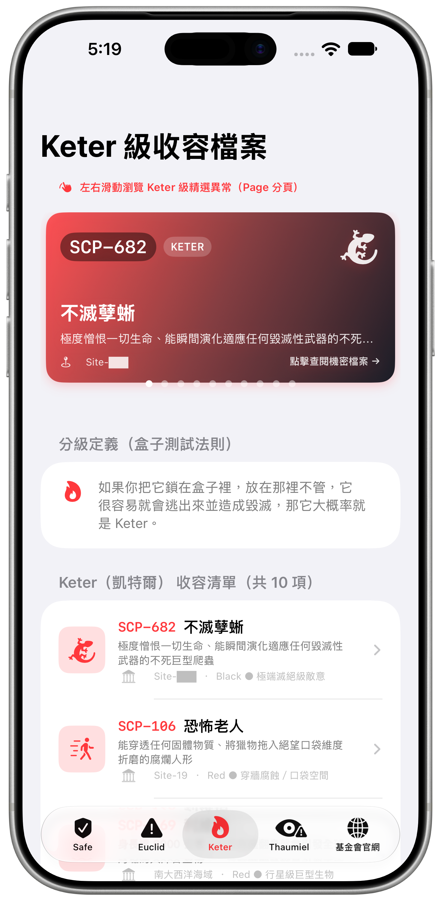
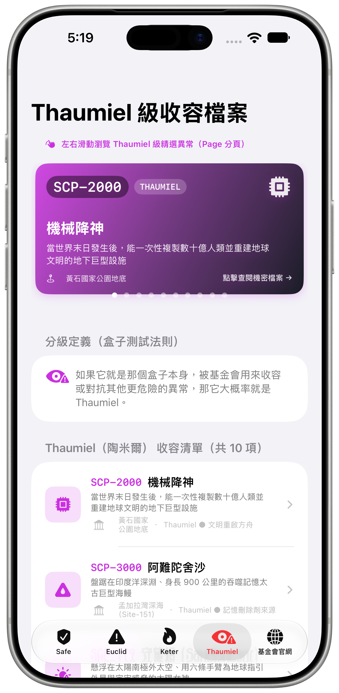
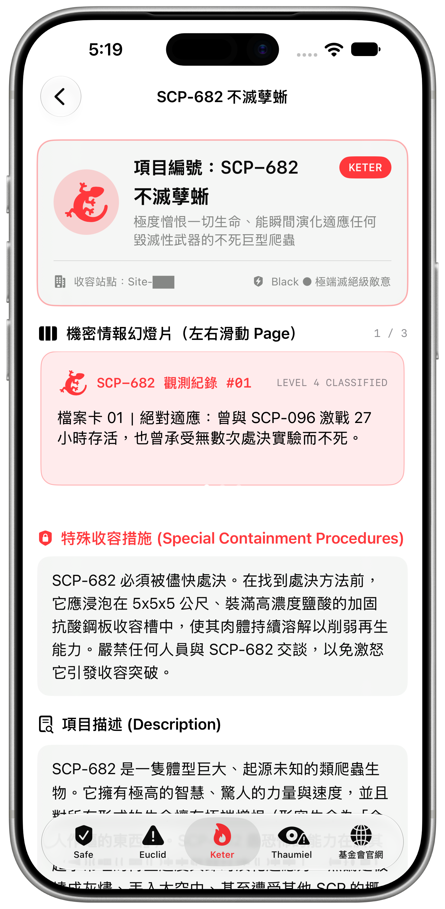
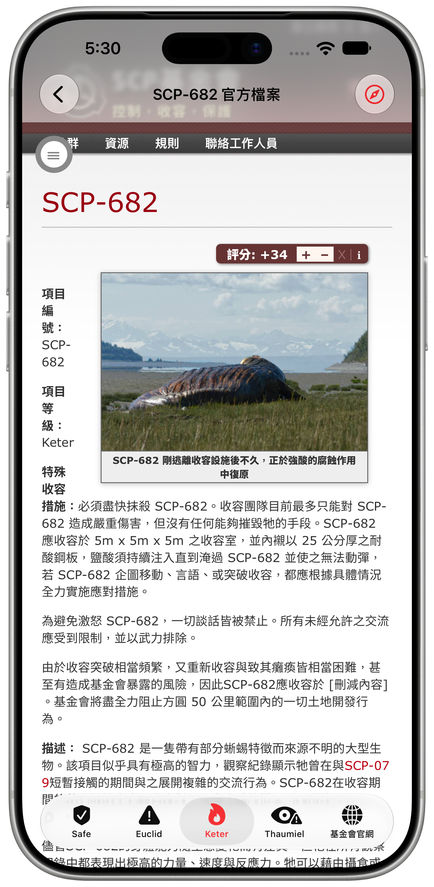
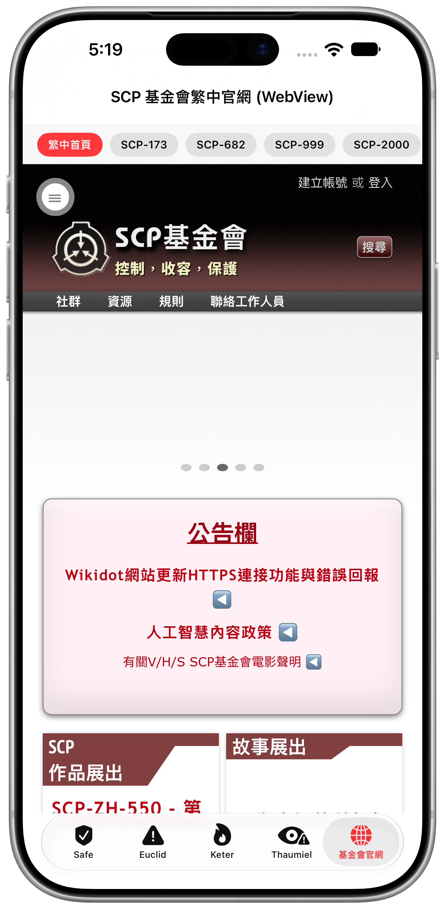
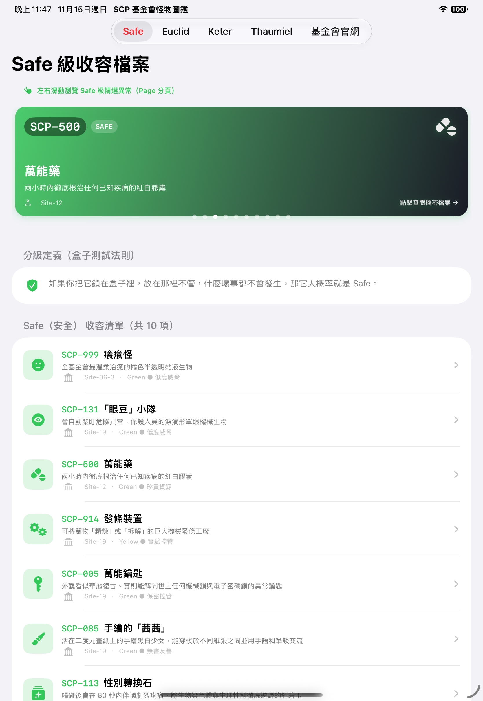

<div align="center">

<a id="top"></a>

# 🛡️ SCP FOUNDATION ARCHIVE
### **SECURE · CONTAIN · PROTECT ｜ 控制 · 收容 · 保護**
**⚠️ TOP SECRET ARCHIVE — CLEARANCE LEVEL 4 / O5 REQUIRED ⚠️**

[](https://swift.org)
[](https://developer.apple.com/xcode/swiftui/)
[](https://developer.apple.com/ios/)
[](https://developer.apple.com/documentation/webkit)
[](https://scp-zh-tr.wikidot.com)
[](https://scp-zh-tr.wikidot.com)

<br />

### 🌐 Language / 語言切換
### **[🇺🇸 English Version](#english) ｜ [🇹🇼 繁體中文版](#chinese)**

</div>

---

<a id="english"></a>

# 🇺🇸 English Version

> **🌍 Switch Language:** **[🇺🇸 English](#english)** | **[🇹🇼 繁體中文](#chinese)**

## 📖 Overview

**SCP Foundation Monster Encyclopedia (`SCP 基金會怪物圖鑑`)** is a sleek, native iOS & iPadOS encyclopedia application built with **SwiftUI** and **WebKit**. Designed like a classified Level-4 / O5 Foundation terminal, this app catalogs **40 iconic SCP anomalies** across the four core Object Classes—**Safe**, **Euclid**, **Keter**, and **Thaumiel** (10 curated entities per class).

Users can browse interactive horizontal paging carousels, learn the Foundation's famous **"Box Test" classification rules**, inspect multi-slide confidential observation logs, read Special Containment Procedures, and seamlessly access the official **Traditional Chinese SCP Foundation Wiki (`scp-zh-tr.wikidot.com`)** directly inside the app via native `WebView`. On **iPadOS**, the app automatically adapts its `TabView` into the modern **floating top Tab Bar** for effortless large-screen navigation.

---

## 🎬 App Demo & Screenshots

### 🎞️ Interactive Operation GIF

<div align="center">
  
  <p><em>👆 Navigating across Object Class tabs, horizontal paging cards, confidential dossiers, and the in-app SCP Wiki WebView.</em></p>
</div>

### 📱 iPhone Interface Screenshots

<div align="center">

#### 🔐 Terminal Launch & Object Class Archives (`Safe` · `Euclid` · `Keter`)

| 🛡️ Terminal Launch Screen | 🟢 Safe Class Archive | 🟠 Euclid Class Archive | 🔴 Keter Class Archive |
| :---: | :---: | :---: | :---: |
|  |  |  |  |
| **Biometric O5 Access**<br/>Animated radar & MTF warning | **SCP-999 & Safe List**<br/>Paging carousel + Box Rule | **SCP-173 & Euclid List**<br/>Unpredictable anomalies | **SCP-682 & Keter List**<br/>High-threat entities |

<br />

#### 🟣 Thaumiel Archive, Confidential Dossiers & Native Wiki WebView

| 🟣 Thaumiel Class Archive | 📁 SCP-682 Classified Dossier | 🌐 In-App Official Dossier WebView | 🧭 SCP Wiki Portal Tab |
| :---: | :---: | :---: | :---: |
|  |  |  |  |
| **SCP-2000 & Thaumiel List**<br/>Counter-anomaly assets | **Observation Slides**<br/>3-page intel & containment | **Direct Wiki Integration**<br/>One-tap Safari handoff | **Quick-Jump Portal**<br/>Instant pill navigation |

</div>

<br />

### 💻 iPadOS Adaptive Layout (Top Floating Tab Bar)

<div align="center">

| 💻 iPad Pro 11-inch — Top Tab Bar Navigation (`TabView` at Top of Screen) |
| :---: |
|  |
| **Native iPadOS Top Tab Bar (`Safe` · `Euclid` · `Keter` · `Thaumiel` · `基金會官網`)**<br/>Automatically elevates the 5-tab bar to a floating capsule at the top of the screen on iPadOS for spacious widescreen browsing |

</div>

> [!TIP]
> **📁 Screenshot & GIF File Paths:** All screenshots and the operation GIF are stored inside the [`screenshots/`](file:///Users/115-1student21/Desktop/SCP%20基金會怪物圖鑑/screenshots) folder at the project root (`demo.gif`, `launch_screen.png`, `safe_list.png`, `euclid_list.png`, `keter_list.png`, `thaumiel_list.png`, `scp_detail.png`, `official_wiki_detail.png`, `official_wiki_tab.png`, `ipad_top_tab.png`).

---

## ✨ Key Features

- 🔐 **Classified Terminal Launch Screen (`SCPLaunchScreenView`)**
  - Atmospheric dark-crimson gradient background with a pulsing Foundation shield emblem, Level 4 / O5 clearance warning banner, and biometric entry trigger.
- 🗂️ **Adaptive 5-Tab Navigation Architecture (`TabView`)**
  - Dedicated tabs for **Safe**, **Euclid**, **Keter**, **Thaumiel**, and the **Official SCP Wiki Portal**, styled with semantic SF Symbols and crimson accent tinting—displaying as a bottom tab bar on iPhone and an **elevated floating top tab bar on iPad**.
- 🎠 **Featured Anomaly Paging Carousel (`TabView` + `.tabViewStyle(.page)`)**
  - Top section of every category list features swipeable gradient hero cards showcasing each anomaly's item code, class badge, tagline, and containment site.
- 📦 **"The Box Test" Classification Guide**
  - Built-in explanation of the SCP Foundation's famous **Box Test Rule** in each category list so readers immediately understand how each Object Class is defined.
- 📑 **Multi-Slide Confidential Dossiers (`SCPDetailView`)**
  - Detailed entity view featuring a color-coded identification header card, a **3-slide horizontal paging observation log (`LEVEL 4 CLASSIFIED`)**, **Special Containment Procedures**, and **Full Item Description**.
- 🌐 **Native SwiftUI `WebView` Integration (`SCPWebPageView` & `SCPWikiPortalTabView`)**
  - Read the original Traditional Chinese SCP Wiki article for any of the 40 anomalies without leaving the app, complete with a quick-jump capsule bar (`繁中首頁`, `SCP-173`, `SCP-682`, `SCP-999`, `SCP-2000`) and external Safari launch button.

---

## 📦 Object Classes & "The Box Test"

The SCP Foundation classifies anomalies based on **containment difficulty** rather than pure destructiveness:

| Class | Badge & Icon | "The Box Test" Rule | Featured Examples (10 per class) |
| :--- | :--- | :--- | :--- |
| **🟢 Safe** | `checkmark.shield.fill` | *"If you lock it in a box, leave it alone, and nothing bad happens, then it's probably **Safe**."* | **SCP-999** (The Tickle Monster), **SCP-131** (The "Eye Pods"), **SCP-500** (Panacea), **SCP-914** (The Clockworks), **SCP-005**, **SCP-085**, **SCP-113**, **SCP-294**, **SCP-458**, **SCP-529** |
| **🟠 Euclid** | `exclamationmark.triangle.fill` | *"If you lock it in a box, leave it alone, and you're not entirely sure what will happen, then it's probably **Euclid**."* | **SCP-173** (The Sculpture), **SCP-096** (The "Shy Guy"), **SCP-049** (Plague Doctor), **SCP-3008** (Infinite IKEA), **SCP-035**, **SCP-079**, **SCP-087**, **SCP-093**, **SCP-178**, **SCP-610** |
| **🔴 Keter** | `flame.fill` | *"If you lock it in a box, leave it alone, and it easily escapes and causes destruction, then it's probably **Keter**."* | **SCP-682** (Hard-to-Destroy Reptile), **SCP-106** (The Old Man), **SCP-169** (The Leviathan), **SCP-2521** (●●\|●●●●●\|●●\|●), **SCP-017**, **SCP-055**, **SCP-939**, **SCP-1048**, **SCP-2317**, **SCP-4666** |
| **🟣 Thaumiel** | `eye.trianglebadge.exclamationmark.fill` | *"If it **is** the box, and is used by the Foundation to contain or counteract other dangerous anomalies, then it's probably **Thaumiel**."* | **SCP-2000** (Deus Ex Machina), **SCP-3000** (Anantashesha), **SCP-179** (Sauelsuesor), **SCP-2140** (Retroconverter), **SCP-1968**, **SCP-2237**, **SCP-2639**, **SCP-2719**, **SCP-2799**, **SCP-3309** |

---

## 🏗️ Project Architecture

```text
SCP 基金會怪物圖鑑/
├── SCP 基金會怪物圖鑑.xcodeproj/       # Xcode Project Configuration
├── screenshots/                       # App Screenshots (iPhone & iPad) & Demo GIF
└── SCP 基金會怪物圖鑑/
    ├── MyApp.swift                    # @main App entry point
    ├── ContentView.swift              # Root 5-tab TabView & Launch Screen sheet
    ├── SCPLaunchScreenView.swift      # Animated O5 biometric security terminal screen
    ├── SCPCategoryListView.swift      # Paging carousel + Box Rule + List + NavigationStack
    ├── SCPDetailView.swift            # Header card + 3-page Intel Slides + Procedures + Wiki Link
    ├── SCPWebPageView.swift           # Native WebKit WebView & SCP Wiki Portal Tab
    ├── SCPModel.swift                 # SCPClass enum, SCPMonster struct & 40-item SCPDatabase
    └── Assets.xcassets/               # AppIcon & AccentColor assets
```

---

## 🛠️ Tech Stack & Requirements

- **Language:** Swift 6.0
- **UI Framework:** SwiftUI (`NavigationStack`, `NavigationLink`, `TabView`, `.tabViewStyle(.page)`, `List`, `ScrollView`, `Material` blur effects)
- **Web Rendering:** `WebKit` (`WebView`)
- **Minimum Deployment:** iOS / iPadOS 18.4+ (macOS / visionOS compatible views)
- **IDE:** Xcode 16.3+ / Xcode 26+

## 🚀 Getting Started

1. **Clone the repository:**
   ```bash
   git clone <your-repository-url>
   cd "SCP 基金會怪物圖鑑"
   ```
2. **Open in Xcode:**
   Double-click `SCP 基金會怪物圖鑑.xcodeproj` to open the project in Xcode.
3. **Build & Run:**
   Select an iPhone or iPad Simulator (e.g., **iPhone 17 Pro Max** or **iPad Pro 11-inch**) and press **`Cmd + R`** to launch the archive.

<div align="right">
  <a href="#top">⬆️ Back to Top</a> ｜ <a href="#chinese">🇹🇼 切換至繁體中文版</a>
</div>

---
---

<a id="chinese"></a>

# 🇹🇼 繁體中文版 (Traditional Chinese)

> **🌍 語言切換：** **[🇺🇸 English](#english)** | **[🇹🇼 繁體中文](#chinese)**

## 📖 專案簡介

**《SCP 基金會怪物圖鑑》** 是一款使用 **SwiftUI** 與 **WebKit** 原生打造的 iOS / iPadOS 機密收容檔案百科 App。整體視覺以「SCP 基金會第 4 級／O5 議會最高機密終端機」為主題，完整收錄 **Safe（安全）**、**Euclid（歐幾里得）**、**Keter（凱特爾）** 與 **Thaumiel（陶米爾）** 四大項目等級各 10 隻、**總計 40 個經典異常實體（SCP）** 的詳細收容檔案。

透過流暢的水平分頁輪播卡片（Page 輪播）、直覺的「盒子測試法則」分級說明、三段式機密觀測紀錄幻燈片，以及內建的 **SCP 基金會繁體中文官網（`WebView`）**，讓特工與研究員能隨時查閱特殊收容措施與原始專案報告。此外在 **iPad** 大螢幕上，`TabView` 會自動適配為位於**畫面正上方的懸浮式頂部導覽列（Top Tab Bar）**，提供更寬廣舒適的閱讀體驗。

---

## 🎬 App 操作 GIF 與畫面截圖

### 🎞️ 實機操作展示 GIF

<div align="center">
  
  <p><em>👆 展示四大異常等級切換、頂部水平滑動精選卡片、機密觀測幻燈片與內建繁中 Wiki 網頁瀏覽。</em></p>
</div>

### 📱 iPhone 畫面截圖一覽

<div align="center">

#### 🔐 生物識別啟動畫面 ＆ 四大項目等級收容清單 (`Safe` · `Euclid` · `Keter`)

| 🛡️ 最高機密啟動畫面 | 🟢 Safe 級收容檔案 | 🟠 Euclid 級收容檔案 | 🔴 Keter 級收容檔案 |
| :---: | :---: | :---: | :---: |
|  |  |  |  |
| **O5 生物識別終端**<br/>動態掃描光圈與 MTF 警告 | **SCP-999 癢癢怪**<br/>安全級精選輪播與收容清單 | **SCP-173 最初之作**<br/>歐幾里得級異常清單 | **SCP-682 不滅孽蜥**<br/>凱特爾級高危滅絕實體 |

<br />

#### 🟣 Thaumiel 級檔案、詳細機密報告與內建繁中 Wiki (`WebView`)

| 🟣 Thaumiel 級收容檔案 | 📁 SCP-682 機密檔案詳情 | 🌐 項目專屬官方檔案 WebView | 🧭 基金會繁中官網分頁 |
| :---: | :---: | :---: | :---: |
|  |  |  |  |
| **SCP-2000 機械降神**<br/>以異常收容異常的最終底牌 | **機密情報幻燈片 (1/3)**<br/>特殊收容措施與項目描述 | **App 內直接閱讀 Wiki**<br/>支援右上角 Safari 開啟 | **快速跳轉膠囊按鈕**<br/>一鍵切換熱門 SCP 頁面 |

</div>

<br />

### 💻 iPad 版面適配展示（重點：Tab 導覽列位於畫面上方）

<div align="center">

| 💻 iPad Pro 11-inch 實機截圖 — 頂部懸浮式 Tab 導覽列（Tab 在畫面上方） |
| :---: |
|  |
| **iPadOS 原生頂部 Tab 導覽列（`Safe` · `Euclid` · `Keter` · `Thaumiel` · `基金會官網`）**<br/>在 iPad 上自動將五大分類 Tab 移至**畫面正上方懸浮膠囊列**，搭配大尺寸卡片與清單呈現更寬廣的機密終端視野 |

</div>

> [!TIP]
> **📁 圖片與 GIF 放置路徑說明：** 所有螢幕截圖（含 iPhone 與 iPad 頂部 Tab 截圖）及操作錄影皆已收納於專案根目錄的 [`screenshots/`](file:///Users/115-1student21/Desktop/SCP%20基金會怪物圖鑑/screenshots) 資料夾中（`demo.gif`、`launch_screen.png`、`safe_list.png`、`euclid_list.png`、`keter_list.png`、`thaumiel_list.png`、`scp_detail.png`、`official_wiki_detail.png`、`official_wiki_tab.png`、`ipad_top_tab.png`）。

---

## ✨ 核心功能亮點

- 🔐 **O5 最高機密終端啟動畫面 (`SCPLaunchScreenView`)**
  - 採用黑紅漸層警戒配色、無限呼吸縮放動畫的基金會盾牌徽章，以及「未經授權存取將派遣機動特遣隊（MTF）進行記憶刪除」的沉浸式警告橫幅。
- 🧭 **跨裝置自適應五大導覽分頁 (`TabView`)**
  - 整合 **Safe**、**Euclid**、**Keter**、**Thaumiel** 四大等級收容庫，以及獨立的 **「基金會官網」** 分頁，搭配對應的 SF Symbols 圖示與紅色主題強調色；在 iPhone 顯示於底部導覽列，在 **iPad 則自動轉換為畫面頂端的懸浮式膠囊 Tab Bar**。
- 🎠 **水平滑動 Page 精選異常輪播 (`TabView` + `.tabViewStyle(.page)`)**
  - 每個等級清單頂部皆設有可左右滑動的漸層精選卡片，直觀展示項目編號、等級膠囊標籤、收容站點與核心標語，點擊即可直接進入機密檔案。
- 📦 **「盒子測試法則」分級定義面板**
  - 於各分類清單內建經典的「盒子測試法則（The Box Test）」說明區塊，幫助使用者一眼掌握 Safe、Euclid、Keter、Thaumiel 四大收容難度差異。
- 🕵️ **多頁式機密情報幻燈片與詳情頁 (`SCPDetailView`)**
  - 點擊任一異常即可透過 `NavigationLink` 傳遞 `SCPMonster` 資料進入詳情頁，內含：
    - **頂部機密識別卡**：顯示 SF Symbol 專屬圖示、收容站點與威脅等級標示（如 `Black ● 極端滅絕級敵意`）。
    - **機密情報幻燈片（3 頁水平滑動 Page）**：展示該異常的 3 張 `LEVEL 4 CLASSIFIED` 關鍵觀測紀錄卡。
    - **特殊收容措施 ＆ 項目描述**：毛玻璃材質（`.regularMaterial`）卡片排版，清晰易讀。
- 🌐 **內建繁體中文 SCP Wiki 原生網頁瀏覽 (`SCPWebPageView`)**
  - 支援從詳情頁底部一鍵開啟該 SCP 的繁中 Wiki 原始網頁，或於「基金會官網」Tab 使用頂部膠囊按鈕快速切換 `繁中首頁`、`SCP-173`、`SCP-682`、`SCP-999`、`SCP-2000`，並提供右上角 Safari 外部開啟功能。

---

## 📦 四大項目等級與「盒子測試法則」

SCP 基金會的項目等級取決於**「收容難度」**而非單純的破壞力，最著名的判斷方式即為**「盒子測試法則（The Box Test）」**：

| 項目等級 | 代表色與圖示 | 📦 盒子測試法則定義 | 收錄代表項目（每級 10 項，共 40 項） |
| :--- | :--- | :--- | :--- |
| **🟢 Safe**<br/>（安全） | 綠色<br/>`checkmark.shield.fill` | *「如果你把它鎖在盒子裡，放在那裡不管，什麼壞事都不會發生，那它大概率就是 **Safe**。」* | **SCP-999** 癢癢怪、**SCP-131**「眼豆」小隊、**SCP-500** 萬能藥、**SCP-914** 發條裝置、**SCP-005** 萬能鑰匙、**SCP-085** 手繪的「茜茜」、**SCP-113** 性別轉換石、**SCP-294** 咖啡機、**SCP-458** 無限披薩盒、**SCP-529** 半貓 Josie |
| **🟠 Euclid**<br/>（歐幾里得） | 橘色<br/>`exclamationmark.triangle.fill` | *「如果你把它鎖在盒子裡，放在那裡不管，你不確定將會發生什麼事，那它大概率就是 **Euclid**。」* | **SCP-173** 雕像 - 最初之作、**SCP-096**「羞澀的人」、**SCP-049** 疫醫、**SCP-3008** 絕對正常的 IKEA、**SCP-035** 附身面具、**SCP-079** 舊 AI、**SCP-087** 樓梯間、**SCP-093** 紅海物件、**SCP-178**「3D」眼鏡、**SCP-610** 憎惡血肉 |
| **🔴 Keter**<br/>（凱特爾） | 紅色<br/>`flame.fill` | *「如果你把它鎖在盒子裡，放在那裡不管，它很容易就會逃出來並造成毀滅，那它大概率就是 **Keter**。」* | **SCP-682** 不滅孽蜥、**SCP-106** 恐怖老人、**SCP-169** 利維坦、**SCP-2521** ●●\|●●●●●\|●●\|●、**SCP-017** 影魔、**SCP-055** [未知]（逆模因）、**SCP-939** 千喉之獸、**SCP-1048** 泰迪熊建造者、**SCP-2317** 異界之門、**SCP-4666** 耶爾蘭人 |
| **🟣 Thaumiel**<br/>（陶米爾） | 紫色<br/>`eye.trianglebadge.exclamationmark.fill` | *「如果它**就是那個盒子本身**，被基金會用來收容或對抗其他更危險的異常，那它大概率就是 **Thaumiel**。」* | **SCP-2000** 機械降神、**SCP-3000** 阿難陀舍沙、**SCP-179** 守望姐、**SCP-2140** 逆時模因、**SCP-1968** 全球性逆時因果環面、**SCP-2237**「萬事俱備，只欠東風」、**SCP-2639** 電動遊戲暴力、**SCP-2719** 內側、**SCP-2799** 領航員、**SCP-3309** 當我們消逝於光明之中 |

---

## 🏗️ 專案檔案結構

```text
SCP 基金會怪物圖鑑/
├── SCP 基金會怪物圖鑑.xcodeproj/       # Xcode 專案設定檔
├── screenshots/                       # App 畫面截圖（iPhone & iPad）與操作 GIF 目錄
└── SCP 基金會怪物圖鑑/
    ├── MyApp.swift                    # @main 應用程式入口
    ├── ContentView.swift              # 根視圖：整合 5 個 Tab 分頁與啟動畫面 Sheet
    ├── SCPLaunchScreenView.swift      # O5 最高機密生物識別啟動畫面（含掃描動畫）
    ├── SCPCategoryListView.swift      # 分類清單頁：Page 輪播卡片 + 盒子法則 + List 導覽
    ├── SCPDetailView.swift            # 機密檔案詳情頁：識別卡 + 3 頁情報幻燈片 + 收容措施
    ├── SCPWebPageView.swift           # WebKit 原生 WebView 封裝與「基金會官網」快速跳轉分頁
    ├── SCPModel.swift                 # SCPClass 列舉、SCPMonster 資料結構與 40 筆完整資料庫
    └── Assets.xcassets/               # 應用程式圖示與色彩資源
```

---

## 🛠️ 技術棧與開發環境

- **程式語言：** Swift 6.0
- **UI 框架：** SwiftUI（`NavigationStack`、`NavigationLink`、`TabView`、`.tabViewStyle(.page)`、`List`、`ScrollView`、`Material` 毛玻璃特效）
- **網頁視圖：** `WebKit` 原生 SwiftUI `WebView`
- **系統需求：** iOS / iPadOS 18.4+（同時相容 macOS / visionOS 條件編譯）
- **開發工具：** Xcode 16.3+ / Xcode 26+

## 🚀 如何執行專案

1. **複製專案儲存庫：**
   ```bash
   git clone <您的專案網址>
   cd "SCP 基金會怪物圖鑑"
   ```
2. **使用 Xcode 開啟：**
   雙擊開啟 `SCP 基金會怪物圖鑑.xcodeproj`。
3. **編譯並執行：**
   選擇任一 iPhone 或 iPad 模擬器（例如 **iPhone 17 Pro Max** 或 **iPad Pro 11-inch**），按下 **`Cmd + R`** 即可啟動機密資料庫。

---

<div align="center">

**🛡️ SECURE · CONTAIN · PROTECT 🛡️**  
*Content adapted from the [SCP Foundation Wiki](https://scp-zh-tr.wikidot.com) under Creative Commons Attribution-ShareAlike 3.0 (CC BY-SA 3.0).*

**[⬆️ Back to Top / 回到頂部](#top) ｜ [🇺🇸 English](#english) ｜ [🇹🇼 繁體中文](#chinese)**

</div>
